# Gestor Financeiro Pessoal

Prova final de Desenvolvimento Web Front-End - Matheus Bau Nardi (ADS, 4º semestre)

Aplicação para controlar receitas e despesas. O frontend é em Angular e consome uma API em Node.js, que guarda os dados no MongoDB Atlas.

Com ela dá para cadastrar entradas e saídas (com categoria, data e valor), ver a lista, filtrar por categoria e tipo, ver o saldo e um gráfico de pizza com os gastos por categoria.

## O que usei

- Angular (criado com Angular CLI)
- Node.js com Express
- MongoDB Atlas com Mongoose
- dotenv, cors e morgan

## Como fiz

### 1. Projeto Angular

Dentro da pasta `Projeto AF` rodei `ng new ProvaAF`.

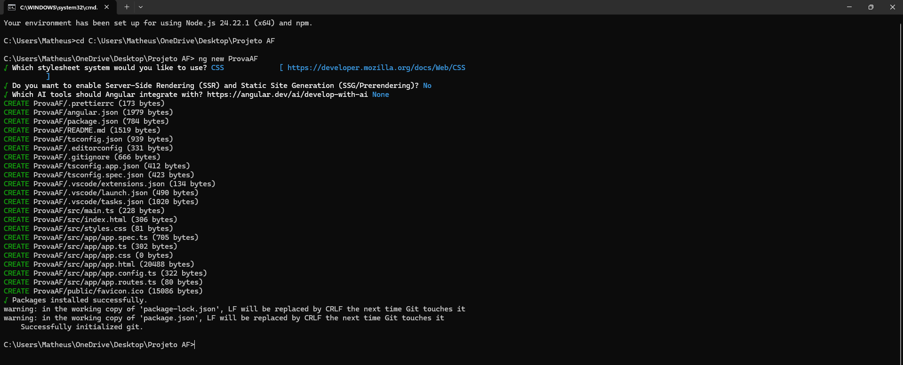

### 2. Backend

Criei a pasta `backend` ao lado da `ProvaAF` (são dois projetos separados) e rodei:

```
npm init -y
npm install express mongoose dotenv morgan cors
```

No `package.json` coloquei `"type": "module"` para poder usar `import`. Criei também o `.env` (string de conexão do Atlas e a porta) e o `.gitignore` para o `.env` não subir pro GitHub.

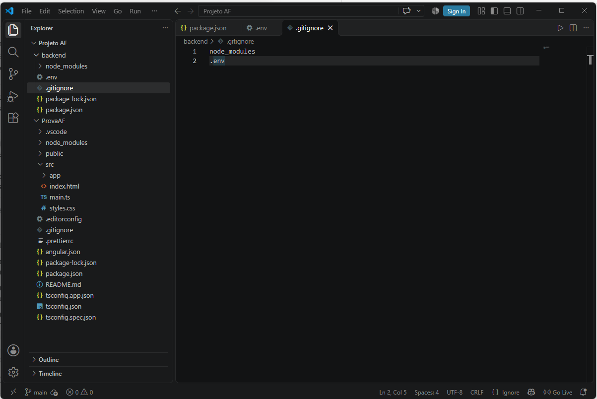

No Atlas criei o cluster grátis, o usuário do banco, liberei o IP em Network Access e criei o banco `Financas` com a coleção `Movimentacoes`.

### 3. server.js

Fiz o `server.js` por partes, seguindo as aulas: conexão com o Mongo, modelo (schema do Mongoose), rota inicial e depois as rotas do CRUD. Também coloquei o `cors` liberando o `localhost:4200`.

Primeiro teste, a rota inicial:

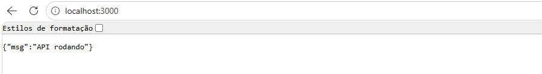

### 4. Testando a API no Insomnia

Rotas que criei:

| Método | Rota | O que faz |
|--------|------|-----------|
| POST | /movimentacoes | cria uma movimentação |
| GET | /movimentacoes | lista todas |
| GET | /movimentacoes/:id | busca uma pela id |
| PUT | /movimentacoes/:id | atualiza |
| DELETE | /movimentacoes/:id | exclui |

Criar (201):

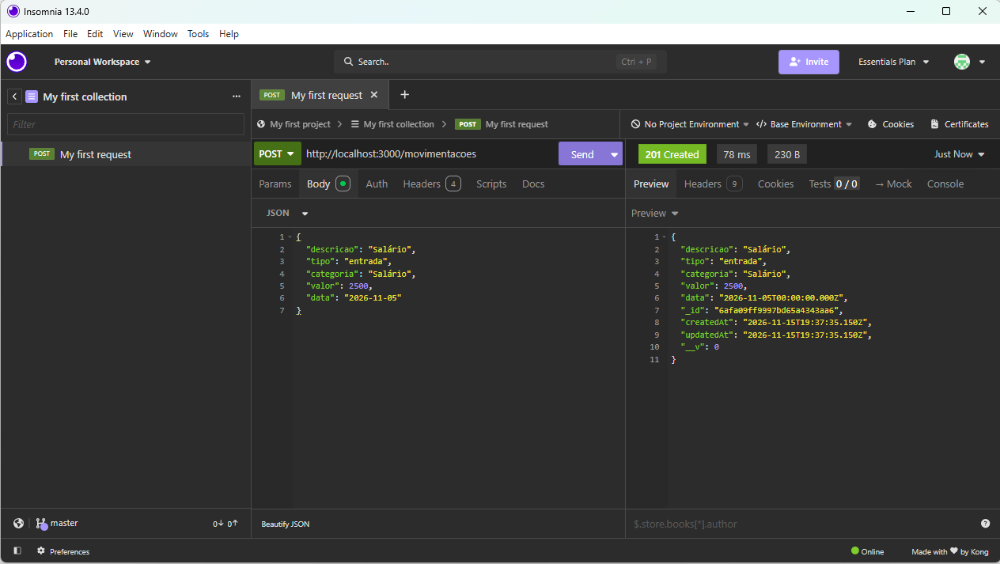

Listar (200):

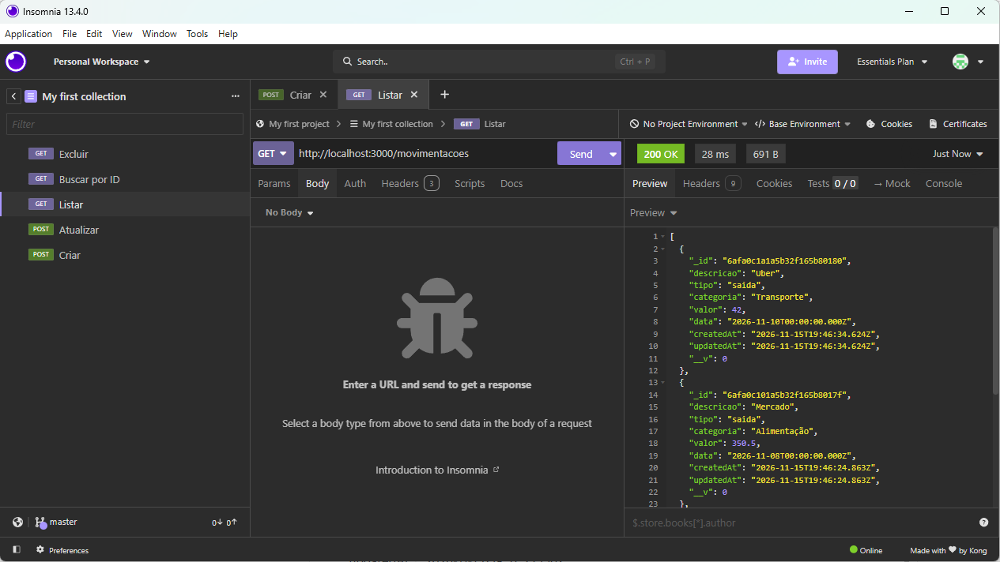

Buscar por id (200) e com id que não existe (404):

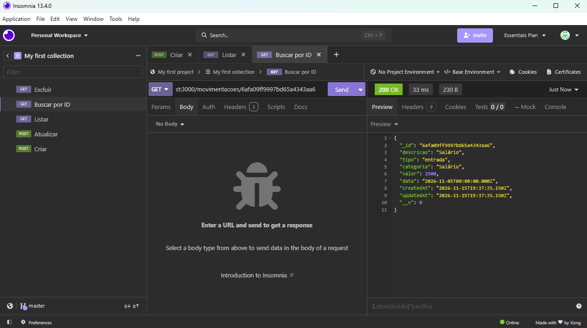

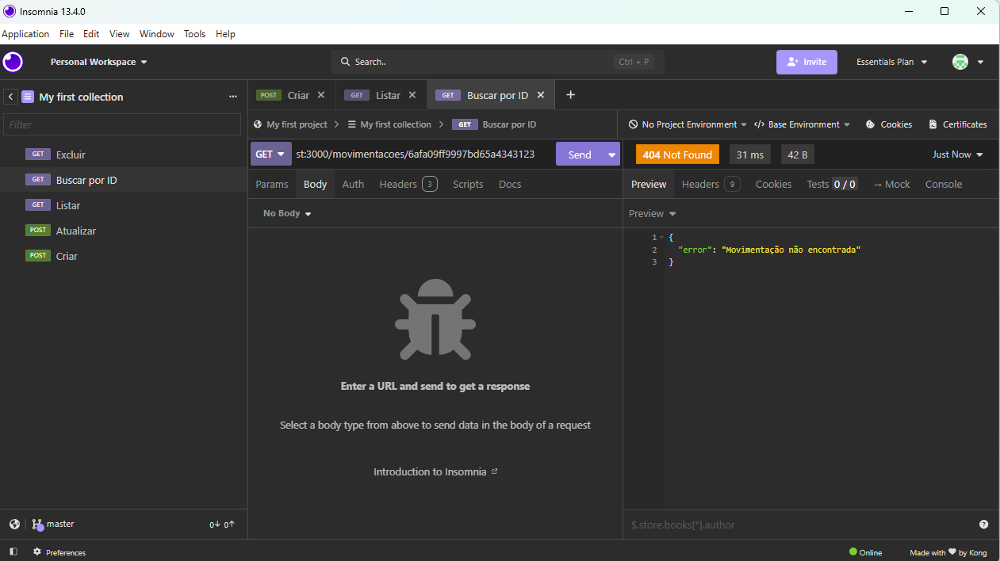

Atualizar com PUT (200):

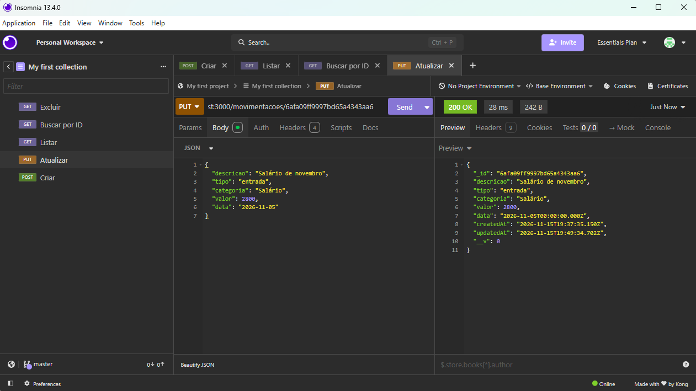

Excluir (200) e excluir de novo, já não existindo mais (404):

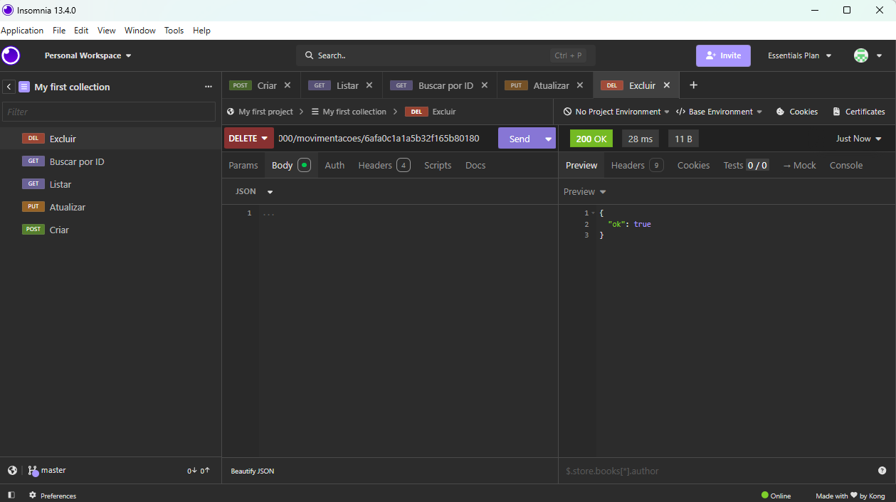

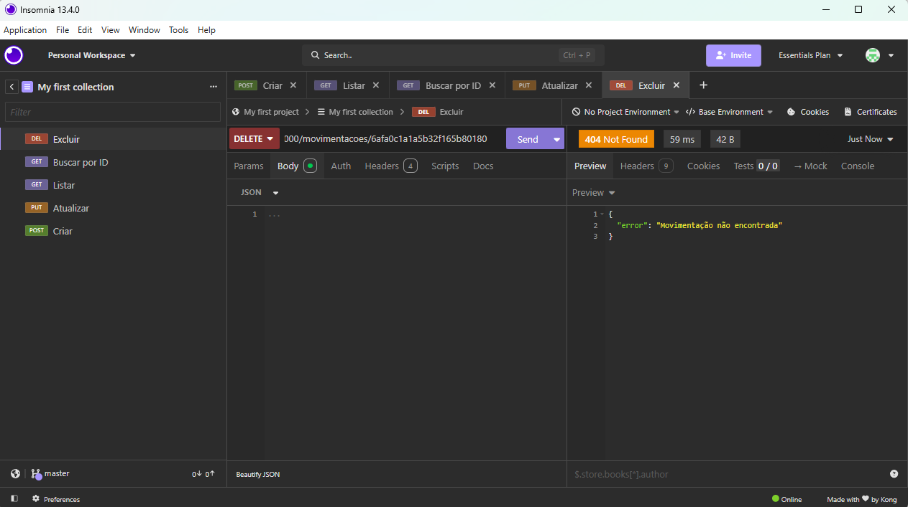

### 5. Frontend

- No `app.config.ts` coloquei o `provideHttpClient(withFetch())`.
- Criei o service com `ng g s services/movimentacoes-service`, com os métodos listar, buscarPorId, criar, atualizar e excluir (usando HttpClient).
- Criei os componentes `lista-movimentacoes` e `cadastrar-movimentacao` com `ng g c`.
- Configurei as rotas: `/lista`, `/cadastro` e `/cadastro/:id` (a mesma tela serve para editar).
- Fiz as categorias em `models/categorias.ts`, cada uma com uma cor.
- O saldo é calculado na lista (entradas menos saídas).
- O gráfico de pizza foi feito só com CSS (`conic-gradient`) e mostra os gastos por categoria. Usei só as saídas porque misturar com o salário esconderia para onde o dinheiro está indo.

Lista com as cores por categoria, saldo e filtros:

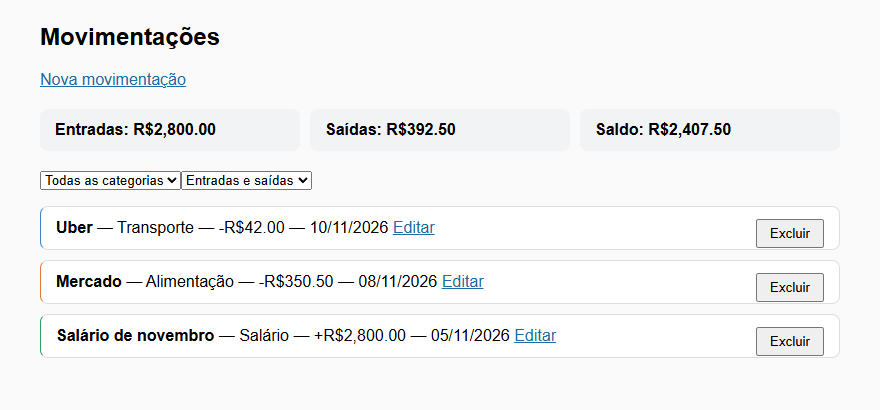

Formulário de cadastro (também usado para editar):

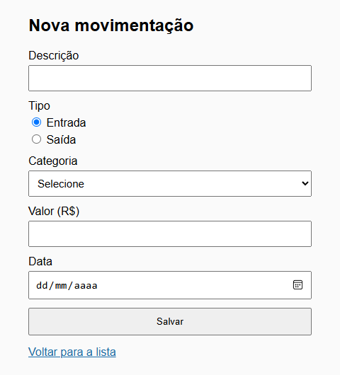

Tela final com o gráfico de pizza:

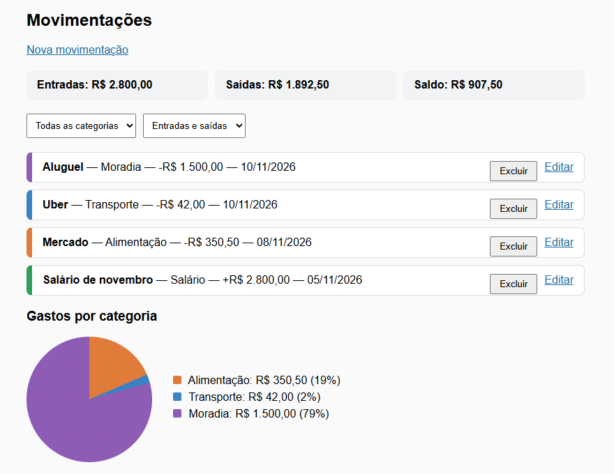

## Dificuldades

- O `package.json` ficou com `"type"` duplicado (`module` e `commonjs`) e o `import` dava erro. Tive que deixar só o `module`.
- O PowerShell bloqueava o comando `ng`, então usei o cmd.
- As datas apareciam um dia errado por causa do fuso, então usei o pipe `date` com `UTC`.
- A tela não atualizava com variáveis normais dentro do `subscribe`, então usei `signal`.
- Erro de import no Angular por causa do arquivo `categorias.ts`, que veio vazio do `ng g interface` e eu precisei escrever o conteúdo.

## Como rodar

Backend:

```
cd backend
npm install
node server.js
```

Precisa de um arquivo `.env` na pasta `backend`:

```
MONGODB_URI=sua-string-do-atlas
PORT=3000
```

Frontend (em outro terminal):

```
cd ProvaAF
npm install
ng serve
```

Depois é só abrir `http://localhost:4200`.
